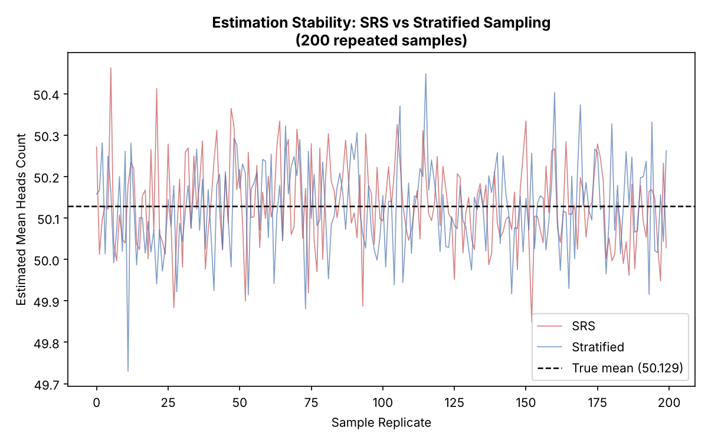
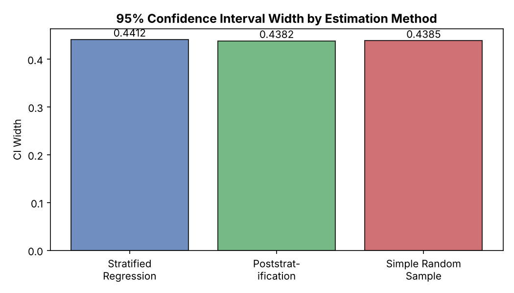

<h1 align="center">Stratified Sampling Simulation Engine</h1>
<p align="center"><i>Does stratifying by coin type actually beat simple random sampling?</i></p>
<p align="center">  </p>

## At a glance
| | |
|---|---|
| **Population** | 40,000 simulated trials: 10,000 each for penny, nickel, dime, quarter. Each trial is 100 flips with P(heads) from 0.500 to 0.503 |
| **Samples** | 2,000 trials per method (500 per coin for the stratified design) |
| **Uncertainty** | 1,000 bootstrap resamples per estimator |
| **Stability test** | 200 repeated samples per sampling design |
| **Finding** | No variance gain from stratification: SD 0.108 (stratified) vs 0.105 (SRS) |

## The question
Do small physical differences between coins create detectable flip bias, and does stratifying by coin type improve the precision of the population-mean estimate?

## Results
| Method | Estimate | SE | 95% CI |
|---|---|---|---|
| Stratified regression | 50.180 | 0.113 | [49.959, 50.400] |
| Post-stratification | 50.311 | 0.112 | [50.092, 50.530] |
| Simple random sample | 50.312 | 0.112 | [50.092, 50.531] |

True population mean: **50.129**. All three intervals contain it. Coin type explains almost none of the trial-level variation (OLS R² = 0.0004), yet the per-coin means differ slightly (quarter 50.376, nickel 49.967).

<p align="center">
 
</p>

## Takeaway
Stratification only pays off when the strata differ a lot. Here the largest gap between coins is under 0.4 heads per 100 flips, so there is no variance reduction. This is a useful boundary case for when stratified sampling matters.

**Note:** Weight was dropped as a regression covariate because it is perfectly collinear with coin type, so the regression adjustment is zero and the estimator reduces to the stratified mean.

## Run it
```
pip install -r requirements.txt
python coin_stratified_sampling.py
```
Plots are saved to the current directory.
